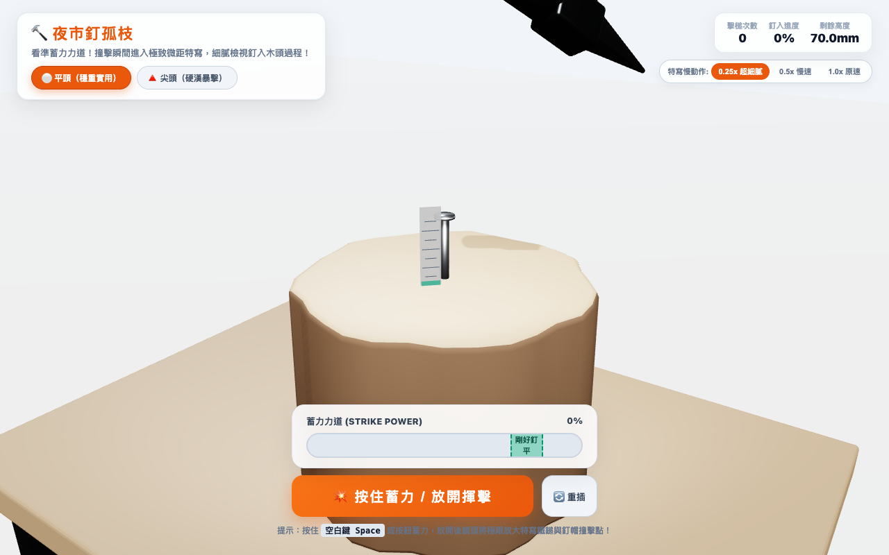

# 🔨 夜市釘孤枝 (Night Market Nail Hammer)

> 台灣經典夜市遊戲「釘孤枝」！一邊平頭、一邊尖頭的鐵鎚，看準力道一槌把大鋼釘剛好釘平！

🎮 **3D 完整版線上試玩**：[https://nutcelvischen-jpg.github.io/night-market-hammer/](https://nutcelvischen-jpg.github.io/night-market-hammer/)  
📱 **手機極速簡化版**：[https://nutcelvischen-jpg.github.io/night-market-hammer-mobile/](https://nutcelvischen-jpg.github.io/night-market-hammer-mobile/)  
🗣️ **配音試聽頁**：[攤主開講試聽](https://nutcelvischen-jpg.github.io/night-market-hammer/voice-preview.html)

---

## 📸 遊戲畫面

---

## 🎯 遊戲特色與玩法

- **一邊平頭・一邊尖頭**：隨時切換平頭（穩重）與尖頭（暴擊穿透）。
- **蓄力揮擊**：按住空白鍵或點擊按鈕蓄力，放開猛力下砸！
- **電影級慢動作**：揮鎚向下那一刻自動觸發 Bullet-Time 慢動作，細膩呈現每一毫米沉入木頭的過程。
- **道地台語配音**：
  - 開場：「叮叮當！敲壞不用賠！」
  - 落空：「你咧拍空氣喔？」/「哎喲，你咧疼伊喔？」
  - 敲歪：「釘仔咧跳舞喔？」/「免賠啦！我心疼爾爾。」
  - 成功齊平：「保利達 B！！」
- **極致輕量 3D**：所有 GLB 模型總計小於 100KB，全裝置流暢 60FPS。

---

## 🛠️ 技術架構

- **渲染引擎**：Three.js (WebGL) + OrbitControls + GLTFLoader
- **3D 建模**：Blender 5.1 (Procedural bmesh, PBR, GLTF export)
- **音效與配音**：Web Audio API 即時物理合成音效 + Gemini 3.8 Flash TTS 道地台語配音
